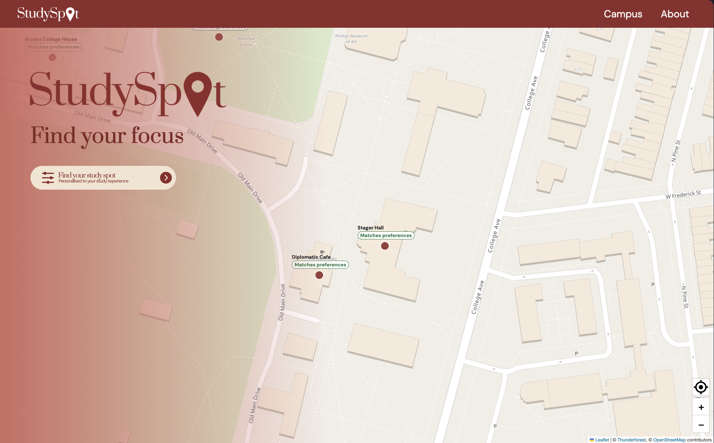
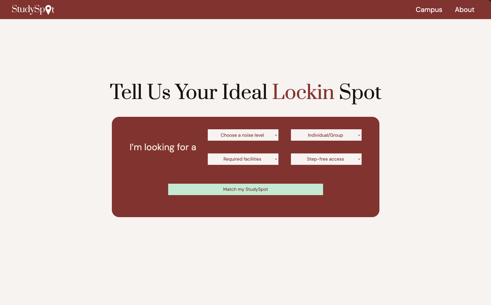
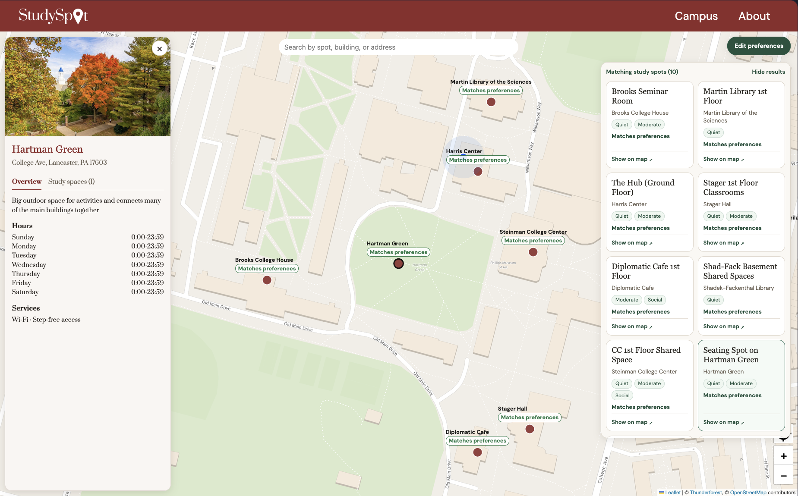
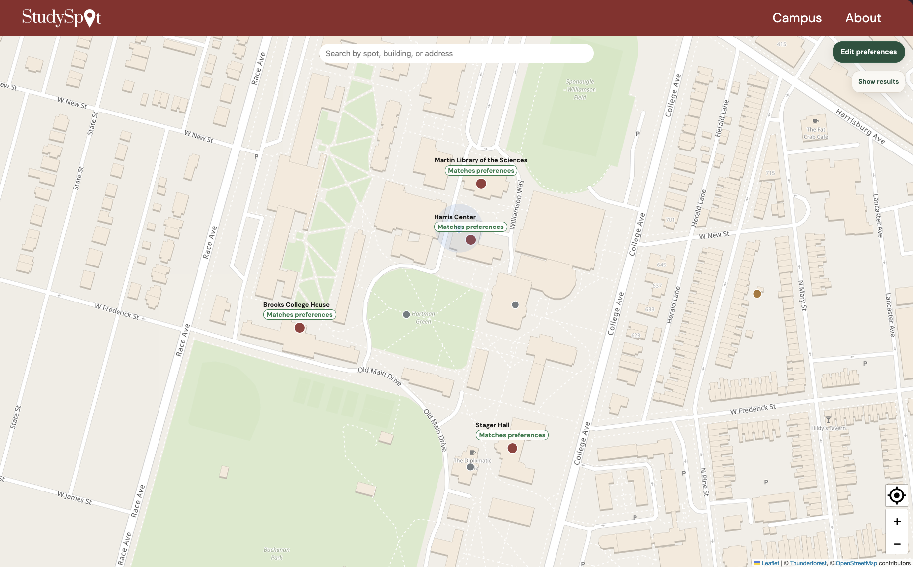

# StudySpot

Find your focus at Franklin & Marshall College.

StudySpot is a campus study-space finder built for a social-good hackathon. Students can choose their preferences, compare recommended rooms, locate buildings on an interactive map, and inspect room information before deciding where to study.

The current sample dataset covers **10 campus locations and 30 study spaces**.

## Features

- Select noise level, individual or group study, required equipment, and step-free access.
- Compare recommended rooms with explanations of their noise match and required amenities.
- See full matches, eligible alternatives, and other campus locations on the map.
- Search eligible buildings by name, category, or address.
- Select a map marker, search result, or recommendation to fly to the building and open its details.
- Browse building descriptions, published hours, amenities, room photos, and sample availability.
- Update preferences during a visit and collapse the results board to explore the map.
- Display your current location and recenter the map with the My location button after granting browser permission.

## Run locally

Use Node.js 22.13 or newer within the Node 22 release line, or Node.js 24+, with npm.

From the repository root, install the dependencies and start the development server:

```bash
cd POE-hack
npm ci
npm run dev
```

Open the local URL printed by Vite, typically `http://localhost:5173`.

### Map configuration

Map tiles use Thunderforest's Atlas style with OpenStreetMap attribution. Set `mapKey` in `src/data/API.jsx` to a valid Thunderforest API key for your deployment. The existing `searchKey` export is unused by the local dataset search.

Map tiles require an internet connection. Browser location access requires permission and a secure context, such as localhost during development or HTTPS when deployed.

### Commands

| Command | Purpose |
| --- | --- |
| `npm run dev` | Start the Vite development server |
| `npm run build` | Build the production site into `dist/` |
| `npm run preview` | Serve the production build locally |
| `npm run lint` | Run ESLint |

For a local production preview:

```bash
npm run build
npm run preview
```

When deploying, use `POE-hack` as the project root and `dist` as the output directory. Configure the host to serve `index.html` for client-side routes such as `/about`.

## App walkthrough

### Start on the campus map

The welcome screen introduces StudySpot over the F&M campus map. Click **Find your study spot** to choose preferences.



### Choose your preferences

Select a noise level, individual or group study, required equipment, and step-free access. Click **Match my StudySpot** to see eligible buildings and recommended rooms. Use **Edit preferences** on the map to update your choices later.



### Compare recommendations and inspect a location

Select a result or map marker to open the building's information card. In this example, Hartman Green's photo, address, description, hours, and services appear beside the recommendation board. The **Study spaces** tab lists the individual spaces and their demo availability.



### Explore the map

Click **Hide results** and close the information card for more room to explore. Full matches keep their labels visible, while eligible alternatives and other locations remain as selectable markers. Click **Show results** to reopen the board.



For a sample search, choose **Quiet**, **Board + TV/Projector**, and **Required** for step-free access. Select **Brooks Seminar Room** from the results, then open **Study spaces** to inspect its amenities.

## How matching works

`src/utils/studySpots.js` implements deterministic matching over the JSON dataset.

1. Check the building's recorded study type against the requested individual or group preference.
2. Filter its rooms by required equipment and step-free access. Every required amenity must be recorded as `"y"` in the same room. Missing or unknown step-free access fails the Required check.
3. Sort eligible rooms so those supporting the requested noise level appear first.
4. Keep buildings with at least one eligible room and show the first eligible room as their recommendation.
5. Rank buildings with noise-matching rooms above eligible alternatives.

**Matches preferences** means an eligible room also supports the selected noise level, or the student has no noise preference. **Other eligible spots** means equipment and access requirements are satisfied while the noise preference is unmet.

All campus locations remain on the map. Buildings failing mandatory requirements receive gray markers, eligible alternatives receive amber markers, and full matches receive burgundy markers with persistent labels.

## Architecture

| Technology | Role |
| --- | --- |
| React | Components and shared application state |
| Vite | Development server and production bundling |
| React Router | Explore, Campus, and About routes |
| React Leaflet and Leaflet | Map, markers, tooltips, and map movement |
| Thunderforest | Map tiles |
| JSON | Campus buildings, rooms, and preference options |
| Browser Geolocation API | User location updates |

`App.jsx` owns the confirmed preferences. `Explore.jsx` computes the eligible results and shares the selected building with search, results, map markers, and the details card. `StudyMap.jsx` tracks the user's location through `watchPosition()`.

```text
POE-hack/
├── docs/images/           Screenshots used in this walkthrough
├── public/                Room and building photos served by URL
├── src/
│   ├── assets/            Logos, user marker, and About page images
│   ├── Components/        Map, preferences, search, markers, and details
│   ├── data/              SpotsList.json, OptionsLists.json, and API config
│   ├── pages/             Explore, Campus, and About
│   ├── styles/            Application and map styles
│   ├── utils/             Matching and map movement
│   ├── App.jsx            Routes and preference state
│   └── main.jsx           React entry point
└── package.json
```

## Updating the data

Edit `src/data/SpotsList.json` to add or update buildings and their `studySpaces`. Each building has an ID, name, address, coordinates, study type, amenities, opening hours, description, source, and verification date. Rooms have their own IDs, names, capacity, noise levels, amenities, and availability.

- Coordinates use `coordinates.lat` and `coordinates.long`.
- Amenity and availability values use `"y"`, `"n"`, or `"u"` for yes, no, or unknown.
- Noise values use lowercase strings such as `"quiet"`, `"moderate"`, and `"social"`.
- Put photos in `public/` and reference them with a root-relative `imageUrl`. For example, `public/1-A.png` is served as `/1-A.png`.
- Use `imageUrl` on a building for its main photo, or on a room for its study-space photo.

## Prototype limitations

- Room availability is randomly assigned sample data and appears as **Demo data** on the cards. It represents a demonstration status, with no connection to occupancy sensors or booking systems.
- All current buildings are tagged `studyTypes: "both"`, so individual and group selections currently produce the same eligible set.
- Preferences last for the current app session and reset on a browser refresh.
- Opening hours and accessibility information come from the collected dataset and should be checked with campus sources before relying on them.
- The Campus route currently contains a placeholder. Building details are available through the Explore map.
